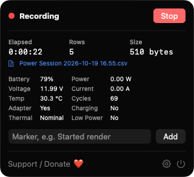
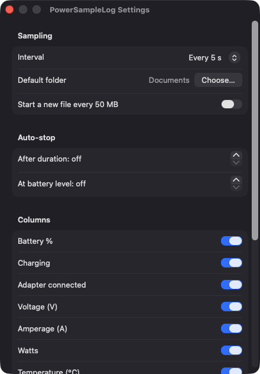
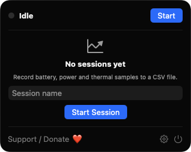

# PowerSampleLog

**🌐 Website:** [turhe123.github.io/power-sample-log](https://turhe123.github.io/power-sample-log/)

Log battery, power and thermal samples to a CSV file you can open in a spreadsheet.


## Why

PowerSampleLog is a free, open-source, 100% native, backend-free alternative to paid utilities in the *System Monitoring* category. It was inspired by tools such as iStatistica Pro ($9.99 one-time), whose CSV export is a handy way to get raw numbers out of a Mac. If you are testing a battery, a charger or a heavy workload and just want a time series you can chart, this app does that one job: it writes readings to a CSV file at the interval you pick, and nothing else. It has no accounts, no network access and no server.

## Features

- **Menu bar app** (window-style `MenuBarExtra`). The icon changes while a session is recording.
- **Sampling interval** of 1, 5, 10 or 60 seconds (default 5).
- **CSV columns:** `timestamp` (ISO 8601 with local offset), `battery_percent`, `charging`, `adapter_connected`, `voltage_v`, `amperage_a`, `watts` (voltage × amperage, negative while discharging), `temperature_c`, `cycle_count`, `low_power_mode`, `thermal_state` (nominal / fair / serious / critical) and `note`.
- **Choose which columns to record** in Settings. `timestamp` and `note` are always written.
- **Session naming and save panel:** pick the file name and location for each session. If the file already exists you can append, replace or cancel.
- **Live stats** in the popover: elapsed time, row count, file size, a link to reveal the file in Finder, and the latest sample values.
- **Markers:** add a row with a note (for example "Started render") from the popover to line up events with the data. Commas, quotes and line breaks in notes are escaped properly.
- **Auto-stop** after a set number of minutes, or when the battery reaches a chosen level. An "Auto-stop" row is written when it triggers.
- **Optional file rotation:** start a new `name-partN.csv` file every 50 MB, without overwriting existing files.
- **Sleep gap markers:** a `GAP` row is written when the Mac wakes, so gaps in the data are explained.
- **Crash-safe writes:** every row is flushed to disk as it is written. If the file becomes unwritable (disk full, volume ejected), recording stops and an alert is shown.
- **No-battery Macs:** only the thermal and Low Power Mode columns are recorded.
- **Global shortcuts:** ⌥⌘L starts/stops recording, ⌥⌘M adds a marker.
- **Default save folder** remembered as a bookmark, and **launch at login** via `SMAppService`.

## Screenshots

<p align="center"></p>

<p align="center"><em>The menu bar popover during a recording session, showing elapsed time, row count, file size, the CSV file link, the latest battery, power and thermal readings, and a field for adding markers.</em></p>

<p align="center"></p>

<p align="center"><em>Settings for the sampling interval, default save folder, 50 MB file rotation, auto-stop rules and which CSV columns to record.</em></p>

<p align="center"></p>

<p align="center"><em>The idle popover, where you name a session and start recording to a new CSV file.</em></p>

## Install

1. Download `PowerSampleLog-macOS.zip` from the [latest release](https://github.com/turhe123/power-sample-log/releases/latest).
2. Unzip it and move `PowerSampleLog.app` to `/Applications`.
3. Because the app is open source and not notarized, clear the quarantine attribute:

   ```bash
   xattr -cr /Applications/PowerSampleLog.app
   ```

4. The first time, right-click the app and choose **Open**.

Requires macOS 14 (Sonoma) or later.

## Build from source

You need Xcode with the macOS SDK and [XcodeGen](https://github.com/yonaskolb/XcodeGen).

```bash
brew install xcodegen
xcodegen generate
xcodebuild -project PowerSampleLog.xcodeproj -scheme PowerSampleLog -configuration Release -derivedDataPath ./build build
```

The app is produced at `build/Build/Products/Release/PowerSampleLog.app`.

## Permissions

PowerSampleLog does not request any special permissions. In particular, it does **not** ask for Accessibility, Screen Recording or Microphone access.

- Battery data is read from the `AppleSmartBattery` IORegistry entry, and thermal and Low Power Mode state from `ProcessInfo`. Neither needs a permission prompt.
- The global shortcuts use Carbon hot keys, which also need no Accessibility permission.
- CSV files are written only to locations you choose in the save panel or Settings.
- "Launch at login" registers a login item through `SMAppService`. macOS may show it under System Settings › General › Login Items.

## Support ❤️

If this app is useful to you, you can support its development:

[Support Or (Leo) Davidai ❤️ on Ko-fi](https://ko-fi.com/leodavidai)

There is also a "Support / Donate ❤️" button in the app.

## License

MIT © Or Davidai Bachar
